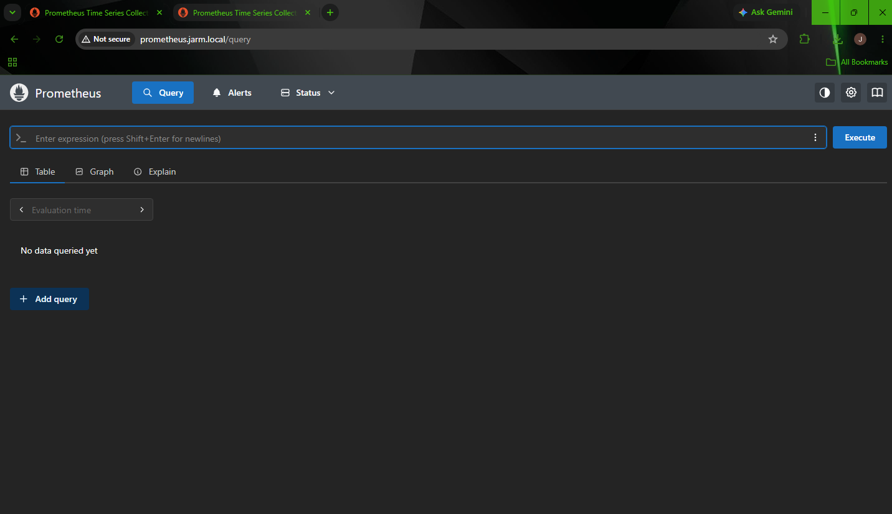
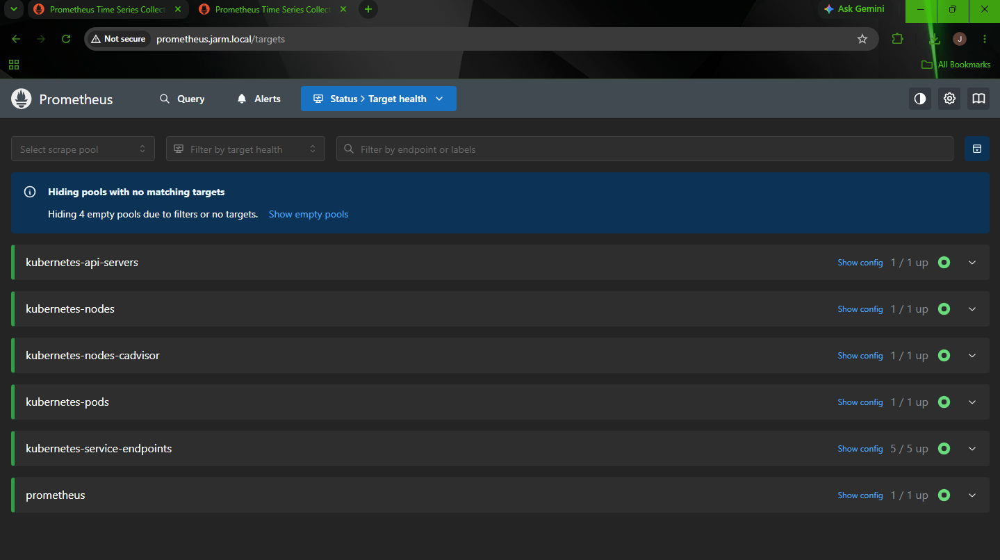
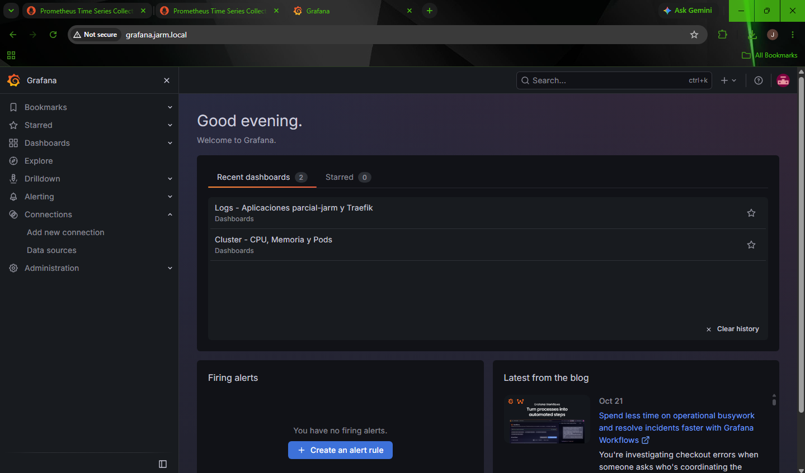
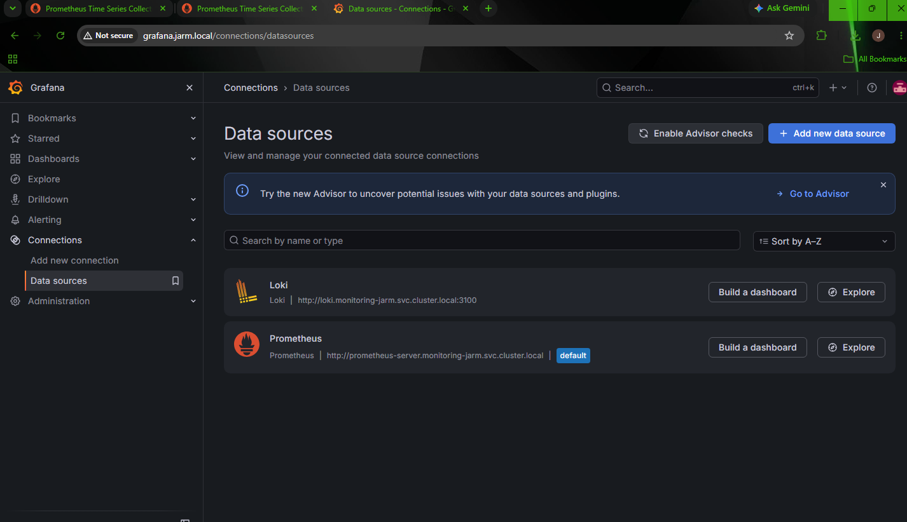
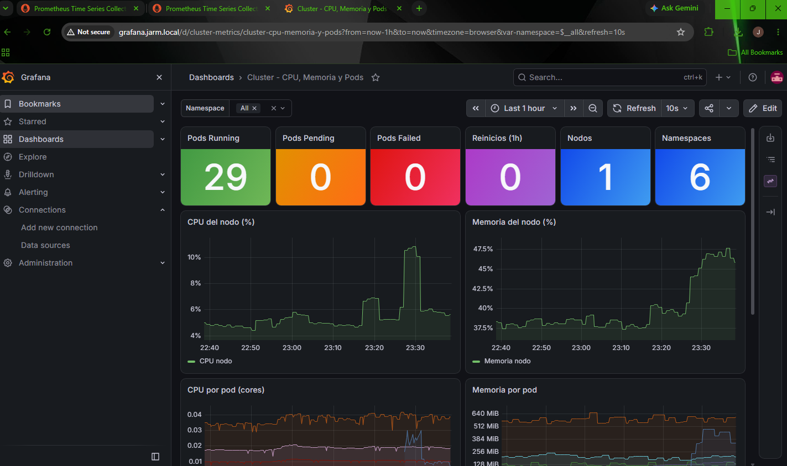
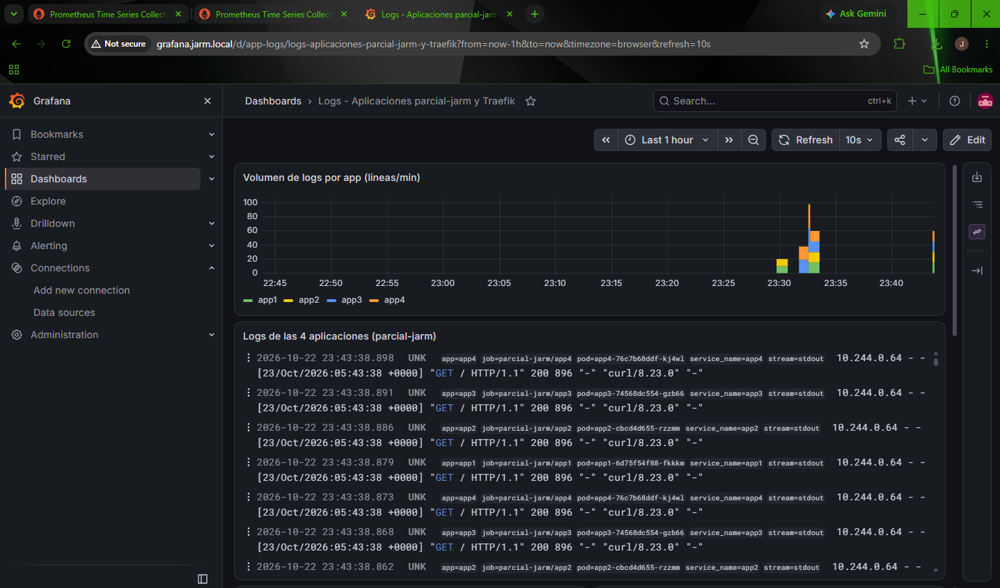

# Virtualizacion
# Monitoreo y centralización de logs en Kubernetes (personal-project-01)

**Autor:** José Antonio Ronquillo Meza (`jarm`)
**Rama:** `personal-project-01` (creada desde `main`)
**Dominio local:** `jarm.local`

Stack de observabilidad dentro del clúster de Minikube de la actividad anterior: **Prometheus** (métricas), **Loki** (almacenamiento de logs), **Promtail** (recolección de logs) y **Grafana** (visualización). Todo vive en el namespace `monitoring-jarm` y se expone a través de **Traefik** con una IP de **MetalLB**.

## 1. Entorno

| Elemento | Valor |
|---|---|
| Sistema operativo | Windows 11 Pro 25H2 |
| Minikube | v1.39.0, driver Hyper-V, runtime containerd |
| VM de Minikube | 4 CPU, 8 GB de RAM |
| Kubernetes | v1.37.0 |
| Helm | v4.3.0 |
| Traefik | chart `traefik/traefik` 42.1.0 (v3.7.15) |
| MetalLB | v0.16.1 (manifiesto nativo, modo L2) |
| Prometheus | chart `prometheus-community/prometheus` 29.37.2 |
| Loki | chart `grafana-community/loki` 19.1.1 (Loki 3.7.9) |
| Promtail | chart `grafana/promtail` 6.17.1 (Promtail 3.5.1) |
| Grafana | chart `grafana-community/grafana` 14.0.1 (Grafana 13.2.4) |

Namespaces: `monitoring-jarm` (stack de monitoreo), `parcial-jarm` (aplicaciones), `traefik`, `metallb-system`, `argocd-jarm`.

## 2. Estructura del repositorio (archivos de esta actividad)

```text
metallb/
  ip-pool.yaml                # IPAddressPool + L2Advertisement (lo regenera el script)
  no-scrape-patch.yaml        # anotación para que Prometheus no consulte pods de MetalLB
traefik/
  values.yaml                 # values del chart de Traefik (sin externalIPs)
scripts/
  update-network.ps1          # pool de MetalLB + ruta estática + archivo hosts
monitoring/
  namespace.yaml              # namespace monitoring-jarm
  prometheus/
    values.yaml
    ingressroute.yaml         # prometheus.jarm.local
  loki/
    values.yaml
  promtail/
    values.yaml
  grafana/
    values.yaml               # data sources y provider de dashboards (provisioning)
    ingressroute.yaml         # grafana.jarm.local
    dashboards/
      cluster-metrics.json    # dashboard de métricas
      app-logs.json           # dashboard de logs
    dashboards-configmap.yaml # ConfigMap con ambos JSON
apps-extra/
  app3.yaml                   # Deployment + Service
  app4.yaml
docs/img/                     # capturas de pantalla
```

## 3. Preparación

### 3.1 Rama

```powershell
git checkout main
git pull origin main
git checkout -b personal-project-01
```

### 3.2 Recursos de la VM

Con 2 CPU el stack iba muy justo, así que se subió la VM (apagada, sin borrar el clúster):

```powershell
minikube stop
Set-VMProcessor -VMName minikube -Count 4
Set-VMMemory -VMName minikube -DynamicMemoryEnabled $false -StartupBytes 8GB
minikube start
```

## 4. MetalLB y Traefik

En el clúster de la actividad anterior Traefik tenía una IP puesta a mano con `service.externalIPs`, y MetalLB no estaba instalado. Se instaló MetalLB y se quitó `externalIPs`.

### 4.1 MetalLB

```powershell
kubectl apply -f https://raw.githubusercontent.com/metallb/metallb/v0.16.1/config/manifests/metallb-native.yaml
kubectl wait -n metallb-system --for=condition=ready pod -l app=metallb --timeout=180s
```

El pool de direcciones (`metallb/ip-pool.yaml`) usa el rango `.200` a `.210` de la subred de la VM. Como Hyper-V cambia la subred del "Default Switch" al reiniciar Windows, el archivo lo genera `scripts/update-network.ps1` a partir de `minikube ip`.

### 4.2 Traefik

`traefik/values.yaml`:

```yaml
ingressClass:
  enabled: true
  isDefaultClass: true
service:
  type: LoadBalancer
```

```powershell
helm upgrade traefik traefik/traefik -n traefik --version 42.1.0 -f traefik\values.yaml
```

El Service conservó la IP vieja en `externalIPs`, así que se eliminó con un parche desde archivo (en Windows PowerShell 5.1 el JSON en línea pierde las comillas):

```powershell
'[{"op": "remove","path":"/spec/externalIPs"}]' | Set-Content -Path "$env:TEMP\patch.json" -Encoding ascii
kubectl patch svc traefik -n traefik --type=json --patch-file "$env:TEMP\patch.json"
```

Resultado: `EXTERNAL-IP` de Traefik con una sola IP, asignada por MetalLB (rango `.200-.210`).

## 5. DNS local y acceso desde Windows

El script `scripts/update-network.ps1` (se ejecuta como Administrador) hace tres cosas:

1. Genera y aplica el pool de MetalLB según `minikube ip`.
2. Espera a que Traefik reciba su IP del pool y agrega una **ruta estática** hacia esa IP por la interfaz `vEthernet (Default Switch)`. Sin esta ruta, Windows enviaba el tráfico por la tarjeta física y la IP no respondía (el ARP de MetalLB L2 no llega a Windows a través del switch de Hyper-V).
3. Actualiza el archivo `C:\Windows\System32\drivers\etc\hosts` (con reintentos, porque otros procesos pueden bloquearlo).

```powershell
powershell -ExecutionPolicy Bypass -File .\scripts\update-network.ps1
```

Entradas resultantes en `hosts` (la IP depende de la subred del momento):

```text
<IP-MetalLB> argocd.jarm.local
<IP-MetalLB> grafana.jarm.local
<IP-MetalLB> prometheus.jarm.local
```

> Después de cada reinicio de Windows hay que volver a ejecutar el script, porque la subred de Hyper-V y la ruta estática no persisten.

## 6. Namespace

`monitoring/namespace.yaml`:

```yaml
apiVersion: v1
kind: Namespace
metadata:
  name: monitoring-jarm
```

```powershell
kubectl apply -f monitoring\namespace.yaml
```

## 7. Prometheus

Se usó el chart `prometheus-community/prometheus`, que incluye `kube-state-metrics` y `node-exporter` y trae configurados los jobs de Kubernetes (apiserver, nodos, cAdvisor, endpoints y pods). Alertmanager y Pushgateway se desactivaron porque no se necesitan. Ver `monitoring/prometheus/values.yaml`.

```powershell
helm repo add prometheus-community https://prometheus-community.github.io/helm-charts
helm repo update
helm install prometheus prometheus-community/prometheus -n monitoring-jarm --version 29.37.2 -f monitoring\prometheus\values.yaml
kubectl apply -f monitoring\prometheus\ingressroute.yaml
```

El `IngressRoute` (`monitoring/prometheus/ingressroute.yaml`) publica el servicio `prometheus-server` en `prometheus.jarm.local` por el entrypoint `web` de Traefik.

**Targets de MetalLB en DOWN.** Los pods de MetalLB traen la anotación `prometheus.io/scrape` y su puerto de métricas (9120) responde por HTTPS con autenticación, por lo que el job `kubernetes-pods` los marcaba `DOWN` (`400 Bad Request`). Esas métricas no forman parte de la actividad, así que se desactivó el scrape en esos pods:

```powershell
kubectl patch deployment controller -n metallb-system --patch-file metallb\no-scrape-patch.yaml
kubectl patch daemonset speaker -n metallb-system --patch-file metallb\no-scrape-patch.yaml
```

Resultado: todos los targets en `UP`.

## 8. Loki

Chart `grafana-community/loki` (desde marzo de 2026 el chart de Loki lo mantiene la comunidad en ese repositorio; el repo `grafana` quedó congelado en la 6.55.0). Se despliega en modo monolítico (`singleBinary`, 1 réplica) con almacenamiento `filesystem` sobre un PVC de 5 Gi, sin autenticación (`auth_enabled: false`). Se desactivaron el gateway, el canary, los tests y las cachés para que quepa en la VM. Ver `monitoring/loki/values.yaml`.

```powershell
helm repo add grafana-community https://grafana-community.github.io/helm-charts
helm repo update
helm install loki grafana-community/loki -n monitoring-jarm --version 19.1.1 -f monitoring\loki\values.yaml
```

Puntos del chart 19.x que hubo que ajustar:

- `singleBinary.replicas` viene en `0` por defecto, se puso en `1`.
- `read`, `write` y `backend` vienen en 3 réplicas por defecto, y con eso el chart se niega a instalar (modo monolítico y simple scalable a la vez), así que se pusieron en `0`.
- El almacenamiento por defecto es `s3`; se cambió a `filesystem`.

Servicio interno: `http://loki.monitoring-jarm.svc.cluster.local:3100`.

## 9. Promtail (DaemonSet)

Chart `grafana/promtail` 6.17.1. Se despliega como DaemonSet (un pod por nodo) y envía los logs a Loki. Se aprovecha el job `kubernetes-pods` del chart, que genera las etiquetas `namespace`, `pod`, `container`, `app` y `job`, y se agrega un `keep` con `extraRelabelConfigs` para recolectar **solo los namespaces `parcial-jarm` y `traefik`**. Como el runtime es containerd, el pipeline por defecto (`cri`) interpreta bien el formato. Ver `monitoring/promtail/values.yaml`:

```yaml
config:
  clients:
    - url: http://loki.monitoring-jarm.svc.cluster.local:3100/loki/api/v1/push
  snippets:
    extraRelabelConfigs:
      - action: keep
        source_labels:
          - __meta_kubernetes_namespace
        regex: parcial-jarm|traefik
```

```powershell
helm repo add grafana https://grafana.github.io/helm-charts
helm install promtail grafana/promtail -n monitoring-jarm --version 6.17.1 -f monitoring\promtail\values.yaml
```

> **Limitación conocida:** Promtail está obsoleto desde Loki 3.0 y su código se eliminó a partir de Loki 3.7.3 (lo reemplaza Grafana Alloy). La actividad exige Promtail, por lo que se fijó la última versión publicada del chart (6.17.1), que sigue funcionando contra Loki 3.7.9 mediante la API de push.

Verificación de que llegan los logs (con `kubectl port-forward -n monitoring-jarm svc/loki 3100:3100`):

```powershell
curl.exe "http://localhost:3100/loki/api/v1/label/namespace/values"
curl.exe "http://localhost:3100/loki/api/v1/label/app/values"
```

## 10. Aplicaciones del namespace `parcial-jarm`

El enunciado pide los logs de 4 aplicaciones. El clúster tenía `app1` (3 réplicas) y `app2` (1 réplica), sincronizadas por Argo CD (`app1-jarm` y `app2-jarm`). Se agregaron `app3` y `app4` con la misma imagen que `app2`, con las etiquetas `app: app3` y `app: app4`, que son las que usan los paneles de Grafana. Los manifiestos están en `apps-extra/` y se aplican directamente, sin pasar por Argo CD (que no elimina recursos que no administra).

```powershell
kubectl apply -f apps-extra\app3.yaml -f apps-extra\app4.yaml
kubectl get pods -n parcial-jarm --show-labels
```

Para generar logs de las 4 apps:

```powershell
kubectl run trafico -n parcial-jarm --rm -i --restart=Never --image=curlimages/curl --command -- sh -c 'for i in 1 2 3 4 5 6 7 8 9 10 11 12 13 14 15; do curl -s -o /dev/null http://app1; curl -s -o /dev/null http://app2; curl -s -o /dev/null http://app3; curl -s -o /dev/null http://app4; done'
```

## 11. Grafana

Chart `grafana-community/grafana` 14.0.1. Todo se configura como código (provisioning), sin pasos manuales en la interfaz. Ver `monitoring/grafana/values.yaml`.

### 11.1 Data sources (provisioning)

```yaml
datasources:
  datasources.yaml:
    apiVersion: 1
    datasources:
      - name: Prometheus
        uid: prometheus
        type: prometheus
        access: proxy
        url: http://prometheus-server.monitoring-jarm.svc.cluster.local
        isDefault: true
      - name: Loki
        uid: loki
        type: loki
        access: proxy
        url: http://loki.monitoring-jarm.svc.cluster.local:3100
```

### 11.2 Dashboards (provisioning)

Los dashboards son archivos JSON en `monitoring/grafana/dashboards/`. Se cargan con un ConfigMap (`dashboards-configmap.yaml`) que el chart monta mediante `dashboardsConfigMaps` y un `dashboardProviders` de tipo `file`:

- **Cluster - CPU, Memoria y Pods** (`cluster-metrics.json`): CPU y memoria del nodo, CPU y memoria por pod, pods Running/Pending/Failed, reinicios, nodos, namespaces y una tabla con el estado de cada pod. Incluye variable `namespace`.
- **Logs - Aplicaciones parcial-jarm y Traefik** (`app-logs.json`): volumen de logs por app, un panel con las 4 aplicaciones juntas (con la etiqueta `app` visible), un panel por cada `app1`, `app2`, `app3` y `app4`, y uno de Traefik. Consultas LogQL, por ejemplo `{namespace="parcial-jarm", app="app1"}`.

> Si se edita un JSON, hay que regenerar `dashboards-configmap.yaml` con el mismo contenido y volver a aplicarlo.

### 11.3 Instalación y exposición

```powershell
kubectl apply -f monitoring\grafana\dashboards-configmap.yaml
helm install grafana grafana-community/grafana -n monitoring-jarm --version 14.0.1 -f monitoring\grafana\values.yaml
kubectl apply -f monitoring\grafana\ingressroute.yaml
```

Acceso: `http://grafana.jarm.local` (usuario `admin`, contraseña `admin123`). La contraseña está en `values.yaml` por simplicidad del ejercicio; en un entorno real se usaría un Secret.

## 12. Evidencias

**Prometheus por dominio (`prometheus.jarm.local`)**



**Targets de Prometheus en UP**



**Grafana por dominio (`grafana.jarm.local`)**



**Data sources provisionados (Prometheus y Loki)**



**Dashboard de métricas del clúster**



**Dashboard de logs (app1, app2, app3, app4 y Traefik)**



## 13. Problemas encontrados y soluciones

| Problema | Causa | Solución |
|---|---|---|
| `minikube start` fallaba con `PROVIDER_HYPERV_NOT_FOUND` | PowerShell sin permisos de administrador | Abrir PowerShell como Administrador |
| El `hosts` y la IP de Traefik no coincidían con `minikube ip` | Hyper-V cambia la subred del Default Switch al reiniciar Windows | `scripts/update-network.ps1` regenera el pool de MetalLB y el `hosts` |
| Traefik no tenía MetalLB, solo `externalIPs` manual | Configuración de la actividad anterior | Instalar MetalLB y quitar `externalIPs` con un parche |
| `curl` a la IP de MetalLB daba timeout desde Windows | Windows enviaba el tráfico por la tarjeta física, no por el switch de Hyper-V | Ruta estática `/32` por `vEthernet (Default Switch)` hacia la IP de la VM |
| Error al escribir el archivo `hosts` | Archivo bloqueado por otro proceso | Reintentos dentro del script |
| `kubectl patch` con JSON en línea fallaba | PowerShell 5.1 elimina las comillas dobles al llamar a programas externos | Pasar el parche con `--patch-file` |
| Targets de MetalLB en `DOWN` (`400 Bad Request`) | Puerto de métricas HTTPS con autenticación y anotación `prometheus.io/scrape` | Anotar los pods con `prometheus.io/scrape: "false"` |
| `helm install` de Loki: más de cero réplicas en monolítico y simple scalable | `read`, `write` y `backend` tienen 3 réplicas por defecto | Poner esas tres réplicas en `0` |
| Chart de Loki no encontrado en el repo `grafana` | El chart se movió a `grafana-community` en marzo de 2026 | Usar el repo `grafana-community` |

## 14. Operación tras reiniciar Windows

1. Abrir PowerShell como Administrador y ejecutar `minikube start`.
2. Ejecutar `powershell -ExecutionPolicy Bypass -File .\scripts\update-network.ps1`.
3. Si se vuelve a aplicar el manifiesto de MetalLB, reaplicar los dos parches de `metallb\no-scrape-patch.yaml`.